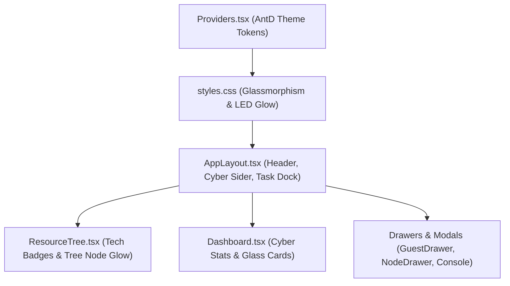

# Kế hoạch Cải tiến Giao diện Proxmox VE Manager (Modern Hi-Tech UI Plan)

## Tổng quan Kiến trúc Giao diện
Cấu trúc giao diện ứng dụng sẽ được nâng cấp tổng thể để chuyển đổi từ giao diện Ant Design Dark mặc định sang phong cách **Hi-Tech Cloud Command Center** với màu nền Cyber Dark Obsidian (`#0b0f19`), điểm nhấn Proxmox Ember Orange (`#ff6b00`) và Electric Cyan (`#00f2fe`), viền mờ Glassmorphism, hiệu ứng LED phát sáng cho trạng thái tài nguyên, và Typography kỹ thuật.

---

## Mẫu Giao Diện Thiết Kế Mới (Visual UI Mockups)

### 1. Dashboard Overview & Cluster Monitor

### 2. Resource Tree & Command Palette Search

### 3. Guest Management & Live Matrix Terminal Console

### 4. Datacenter Infrastructure: SDN Topology & Firewall Matrix

### 5. Security Vault & Access Control Matrix

---

## Các Tệp Tin Trọng Tâm Cần Thay Đổi

1. **[apps/desktop/src/renderer/app/Providers.tsx](apps/desktop/src/renderer/app/Providers.tsx)**:
   * Tùy chỉnh Ant Design `ConfigProvider` Theme Tokens:
     * `colorBgBase`: `#0b0f19` (Obsidian Dark)
     * `colorBgContainer`: `#121826`
     * `colorBgElevated`: `#182032`
     * `colorPrimary`: `#ff6b00` (Electric Orange)
     * `colorInfo`: `#00f2fe` (Cyber Cyan)
     * `colorSuccess`: `#00f5a0` (Tech Emerald)
     * `borderRadius`: `6px`
     * `colorBorder`: `#232f48`
     * `colorBorderSecondary`: `#1b253b`

2. **[apps/desktop/src/renderer/styles.css](apps/desktop/src/renderer/styles.css)**:
   * Thêm các CSS utility classes cho hiệu ứng công nghệ:
     * `.tech-glass-card`: Background mờ kính `rgba(18, 24, 38, 0.75)`, `backdrop-filter: blur(12px)`, viền mỏng glowing `1px solid rgba(0, 242, 254, 0.15)`.
     * `.led-indicator-online`, `.led-indicator-running`, `.led-indicator-stopped`: Đèn LED tròn với hiệu ứng `box-shadow: 0 0 8px <color>`.
     * Custom Scrollbar kiểu Cyberpunk mỏng gọn (`rgba(0, 242, 254, 0.3)`).
     * Background pattern micro-grid phủ mờ toàn ứng dụng.

3. **[apps/desktop/src/renderer/app/AppLayout.tsx](apps/desktop/src/renderer/app/AppLayout.tsx)**:
   * Thiết kế lại Header với viền gradient phát sáng, Logo thương hiệu công nghệ cao.
   * Cập nhật Sider Menu với icon hiệu ứng hover cyan/orange, phân cách kính mờ giữa Navigation và Resource Tree.
   * Thêm hiệu ứng glowing cho Connection Status Badge.

4. **[apps/desktop/src/renderer/features/resources/ResourceTree.tsx](apps/desktop/src/renderer/features/resources/ResourceTree.tsx)**:
   * Cập nhật Icon hiển thị cho Datacenter, Node, QEMU VM, LXC Container, Storage.
   * Tích hợp LED status dot kế bên từng máy ảo/LXC (Xanh lá: online, Xanh dương: running, Đỏ/Xám: stopped).
   * Thêm badge chỉ số CPU/RAM mini kiểu Monospace bên cạnh tên tài nguyên.

5. **[apps/desktop/src/renderer/routes/Dashboard.tsx](apps/desktop/src/renderer/routes/Dashboard.tsx)**:
   * Bọc các thẻ thống kê tổng quan (CPU, Memory, Storage, Health) bằng `.tech-glass-card`.
   * Tạo các thanh Progress bar / Radial Gauges phản quang mượt mà với tông màu Cyan và Ember Orange.

6. **[apps/desktop/src/renderer/features/tasks/TaskDock.tsx](apps/desktop/src/renderer/features/tasks/TaskDock.tsx)**:
   * Thiết kế lại Dock nhật ký công việc phía dưới chuẩn phong cách Command Line Terminal: chữ Monospace mỏng, nhãn trạng thái OK/RUNNING/FAIL neon.

---

## Chi Tiết Các Bước Triển Khai (Todos)

* **[theme-setup]**: Cấu hình Ant Design Theme Tokens trong `Providers.tsx` & thiết lập CSS Glassmorphism / LED Glow / Micro-grid trong `styles.css`.
* **[layout-redesign]**: Nâng cấp `AppLayout.tsx` với Header Cyberpunk, Connection Switcher nâng cấp, Sider Menu phong cách Hi-Tech.
* **[resource-tree-ui]**: Làm mới `ResourceTree.tsx` với LED status dots, nhãn Monospace, bôi sáng hover hiệu ứng Neon.
* **[dashboard-ui]**: Đổi mới `Dashboard.tsx` thành Cyber Command Overview với các thẻ Glass Cards, Gauge hiển thị tài nguyên thời gian thực.
* **[dock-drawers-ui]**: Tối ưu hóa `TaskDock.tsx` và các Drawer (GuestDrawer, NodeDrawer) chuẩn phong cách Dark Terminal.
