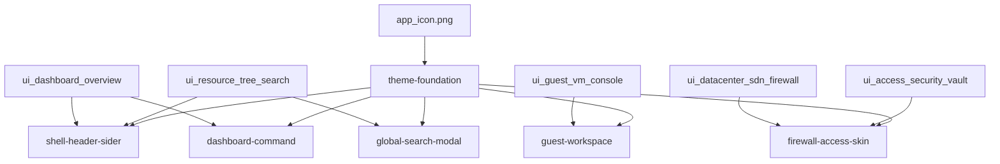

# Kế hoạch UI bám mockup (Modern Hi-Tech)

Nguồn chân lý visual: [`docs/ui-mockups/`](docs/ui-mockups/). Mục tiêu: app **giống ảnh mẫu nhất có thể** trên dữ liệu/API Proxmox đã có; không bịa widget (IPS/DDoS, live TOTP secret, Matrix feed, FPS VNC).

---

## Palette & design system (từ mockup)

| Token | Giá trị | Dùng cho |
|---|---|---|
| `colorBgBase` | `#0b0f19` / `#0b0e14` | Nền app |
| `colorBgContainer` | `#121826` | Card / panel |
| `colorBgElevated` | `#182032` | Modal / dropdown |
| `colorPrimary` | `#ff6b00` | Brand / warning / CTA cam |
| `colorInfo` | `#00f2fe` | Focus, viền glow, link |
| `colorSuccess` | `#00f5a0` | Running / healthy / LED online |
| `colorError` | `#ff4d6d` | Stop / fail |
| `colorBorder` | `#232f48` + cyan `rgba(0,242,254,0.15–0.35)` khi active | Viền glass |
| Radius | `8–12px` cards (mockup); controls vẫn compact | Khớp ảnh hơn plan cũ `6px` |
| Font | Sans UI (giữ stack sạch / thêm font kỹ thuật nếu cần); **mono** cho % / UPID / fingerprint | Không mono toàn app |

**CSS utilities** trong [`styles.css`](apps/desktop/src/renderer/styles.css):
- `.tech-glass-card` — blur + nền bán trong suốt + viền cyan mỏng
- `.led-online` / `.led-running` / `.led-stopped` / `.led-warn` — dot + `box-shadow` glow
- `.neon-border` / `.neon-border-active` — header search, modal, selected tree row
- Cyber scrollbar; micro-grid nền **opacity rất thấp** (tránh làm bảng khó đọc)
- `prefers-reduced-motion`: tắt pulse glow

**Files:** [`Providers.tsx`](apps/desktop/src/renderer/app/Providers.tsx), [`styles.css`](apps/desktop/src/renderer/styles.css), optional `theme/tokens.ts`. Icon: copy/adapt [`docs/ui-mockups/app_icon.png`](docs/ui-mockups/app_icon.png) → header mark + [`apps/desktop/resources/icon.png`](apps/desktop/resources/icon.png).

Giữ `darkAlgorithm` + `compactAlgorithm` — mật độ admin như mockup, không phóng padding marketing.

---

## Phase A — Shell = `ui_dashboard_overview` + `ui_resource_tree_search` (chrome)

### Header ([`AppLayout.tsx`](apps/desktop/src/renderer/app/AppLayout.tsx))
Bám hàng trên mockup dashboard:
- Trái: logo `app_icon` + “PROXMOX VE” / “SERVER MANAGER”
- Giữa: ô search (mở Global Search) + hint phím
- Phải: **health chips** Cluster / Quorum / Ceph (aggregate từ `/cluster/resources` + cluster config + ceph status nếu có; fallback “—” / ẩn Ceph khi không có)
- Bell → link/drawer gần [`ClusterLogPage`](apps/desktop/src/renderer/routes/ClusterLogPage.tsx) (không invent inbox)
- Connection switcher + user `root@pam`-style + settings; nút **Create VM / Create CT** đưa lên header (logic wizard đã có ở Dashboard)

### Sider + Tree
- Menu nav glow khi active (cyan)
- [`ResourceTree`](apps/desktop/src/renderer/features/resources/ResourceTree.tsx): LED thay `Badge` antd; icon VM/CT/Storage/Node; hover/selected neon border
- Warning triangle khi node/guest degraded (map `status` / high usage nếu có sẵn trên resource)
- **Không** nhồi CPU/RAM badge mọi hàng (mockup để metrics ở dashboard) — optional chỉ node header

### TaskDock
Skin terminal: mono labels, tag `OK` / `RUNNING` / `FAIL` neon — [`TaskDock.tsx`](apps/desktop/src/renderer/features/tasks/TaskDock.tsx)

---

## Phase B — Global Search = `ui_resource_tree_search`

Viết lại [`GlobalSearch.tsx`](apps/desktop/src/renderer/features/resources/GlobalSearch.tsx):
- Modal full glass, viền cyan glow, title + shortcut (`Ctrl+K` / tương đương hook hiện có)
- Kết quả **nhóm**: Virtual Machines / LXC / Storage / Nodes
- Mỗi hàng: LED status, type tag, tên/vmid; storage có progress `disk/maxdisk`
- Quick actions: Start / Stop / Console — reuse pattern [`GuestOps`](apps/desktop/src/renderer/features/resources/GuestOps.tsx) / `TaskButton` / console navigate
- **IP:** chỉ hiện nếu đã có trong resource/agent cache; không block UI để gọi agent hàng loạt

---

## Phase C — Dashboard = `ui_dashboard_overview`

Viết lại layout [`Dashboard.tsx`](apps/desktop/src/renderer/routes/Dashboard.tsx) (data từ `useClusterResources` + RRD node khi cần):

1. **Summary row** — Nodes online, VMs running x/y, CTs running x/y, Storage active, Uptime (max/min node uptime)
2. **Gauges row** — 3 glass cards CPU / RAM / Disk: **SVG donut** + % + “x of y”; sparkline từ RRD 1 node đại diện hoặc aggregate nhẹ (uPlot area nhỏ, không lib mới)
3. **Lower grid** — (trái) multi-series usage chart nếu gom được RRD; (giữa) Top nodes/VMs by CPU bars từ `/cluster/resources`; (phải) Quick metrics: replication/backup/task counts nếu query sẵn có, không thì ẩn
4. **Alerts strip** — vài dòng từ cluster log API (reuse ClusterLog)
5. Giữ bảng guests phía dưới hoặc tab phụ nếu cần thao tác tạo nhanh — ưu tiên bố cục mockup trước, table không phá hero overview

Time range selector: wire `hour` RRD trước; các timeframe khác nếu endpoint đã support.

---

## Phase D — Guest = `ui_guest_vm_console` (gần nhất có thể)

Hiện tại: [`GuestDrawer`](apps/desktop/src/renderer/features/resources/GuestDrawer.tsx) tabs. Để giống mockup:

**Layout mục tiêu (trong shell hiện tại):**
- Đổi guest detail từ drawer hẹp → **wide drawer / split panel** (~90% width hoặc embed trong content khi selected):
  - **Trên:** title VM, LED running, uptime, action bar lớn (Start / Shutdown / Snapshot / Console / More)
  - **Trái-giữa:** hardware summary table + **4 mini RRD** (cpu, mem, netin/netout, diskread/diskwrite — keys RRD đã có)
  - **Giữa-dưới:** Console tab nổi (`GuestConsoleTab` / VNC) với chrome nút CAD / Clipboard / Fullscreen (đã có)
  - **Phải:** panel Hardware form nhanh (CpuMemory + Network firewall toggle) — extract từ forms hiện có, không rewrite schema

**Cố ý bỏ / không fake:** Matrix Live Feed, FPS/Latency VNC, QEMU version footer nếu API không có.

Node system list trong mockup sidebar trái = giữ `ResourceTree` + `NodeDrawer` (không nhân đôi nav giả).

---

## Phase E — Firewall / Access / SDN skin

### Firewall ([`FirewallPage.tsx`](apps/desktop/src/renderer/features/firewall/FirewallPage.tsx))
- Bọc glass cards; bảng rules style “matrix”: pill ACCEPT/DROP neon, toggle enable, search — **bám cột API thật**
- Summary chips đếm rules / enabled nếu derive được
- **Không** làm Blocked/Allowed packets 24h, Threat Protection, GeoIP (không có trong PVE API)

### SDN ([`DatacenterExtrasPage` / SdnTab](apps/desktop/src/renderer/features/datacenter/DatacenterExtrasPage.tsx))
- Cards đếm zones / vnets từ list API
- **Topology đơn giản:** graph SVG/HTML từ zones→vnets (force-layout nhẹ hoặc hierarchical) — gần mockup về bố cục, không cần minimap/threat legend đầy đủ
- Nếu graph quá nặng cho một PR: cards + bảng skin trước, graph là bước E2 ngay sau

### Access ([`AccessPage.tsx`](apps/desktop/src/renderer/features/access/AccessPage.tsx))
- Dashboard cards trên tabs: Users / Tokens / TFA status / Cert trust summary
- Bảng tokens: pills scope, status ACTIVE/EXPIRED (expire từ API)
- Permission **matrix rút gọn** (user × role/capability) derive từ ACL+roles nếu làm được trong client; không thì giữ ACL table nhưng skin giống vault cards
- Cert inspector card reuse [`CertTrustModal`](apps/desktop/src/renderer/features/connections/CertTrustModal.tsx) / node certs — fingerprint mono + copy
- **Không** hiện mã TOTP sống / countdown giả

---

## Thứ tự triển khai & PR

| Todo | Mockup neo | Độ xâm lấn |
|---|---|---|
| `theme-foundation` | icon + mọi ảnh | Thấp — unlock toàn app |
| `shell-header-sider` | dashboard + search chrome | Trung bình |
| `global-search-modal` | `ui_resource_tree_search` | Trung bình — ROI visual cao |
| `dashboard-command` | `ui_dashboard_overview` | Trung bình–cao (layout mới) |
| `guest-workspace` | `ui_guest_vm_console` | Cao (IA drawer→split) |
| `firewall-access-skin` | sdn + access | Trung bình (+ graph tùy chọn) |

Mỗi phase xong: chạy trên mock `DISPLAY=:1 PVE_E2E_MOCK_URL=... npm run dev`, so ảnh mẫu; `npm test && npm run typecheck && npm run lint`.

---

## Tiêu chí “giống mẫu”

**Phải đạt (Phase A–D):**
- Cùng palette, glass cards, LED, neon focus
- Header chips + search modal grouped + dashboard gauges/summary
- Guest action bar + 4 charts + console chrome nhìn gần mockup

**Chấp nhận lệch:**
- Không có threat/ops widgets bịa
- Sider nav vẫn route thật của app (không copy hết label mockup không tồn tại)
- Guest chưa phải 3-column window riêng nếu Electron constraint — wide split trong app window là đủ

**Không làm trong plan này:** thay Ant Design, light mode, fake telemetry, redesign toàn bộ form field từng tab.
