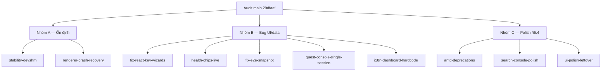

# Kế hoạch ổn định hoá & polish sau audit (08/2026)

Kết quả audit toàn diện trên `main` (`29dfaaf`) — test tự động + test GUI thủ công trên mock
(`cluster-3node`, `broken-cluster`, `huge`) đối chiếu [docs/ui-mockups/](../../docs/ui-mockups/),
[plan.md](../../docs/plan.md) và [handoff.md](../../docs/handoff.md). Chi tiết hiện trạng ghi ở
handoff §7.

**Trạng thái đo được:** unit 265 passed / 9 skipped; typecheck + lint sạch; electron-e2e
**8/9** (1 fail thật, xem `fix-e2e-snapshot`); hiệu năng fixture `huge` (8 node / 400 guest)
tốt — tree/search/drawer đều mượt.



---

## Nhóm A — Ổn định (làm trước)

### A1. `stability-devshm` — renderer crash trên container /dev/shm nhỏ

**Triệu chứng đo được:** trên cloud VM (`/dev/shm` = **64 MB**, mặc định Docker), mở
GuestDrawer (4 canvas uPlot + noVNC canvas mount cùng lúc) → renderer chết
`render-process-gone { reason: 'crashed', exitCode: 5 }`, cửa sổ đen vĩnh viễn. Tái hiện
100% qua 3 phiên test độc lập; kèm lỗi GPU
`ContextResult::kTransientFailure: Failed to send GpuControl.CreateCommandBuffer`.
Chạy lại với `--disable-dev-shm-usage` → **hết crash hoàn toàn**, mọi luồng (drawer, console,
snapshot, start/stop, search) chạy ổn.

**Việc:**
- [`apps/desktop/src/main/index.ts`](../../apps/desktop/src/main/index.ts): trước
  `app.whenReady()`, nếu `process.platform === 'linux'` và `statfsSync('/dev/shm')` cho
  dung lượng < ~256 MB → `app.commandLine.appendSwitch('disable-dev-shm-usage')`
  (Chromium chuyển shared memory sang `/tmp`; an toàn, chỉ chậm hơn không đáng kể).
- [`apps/desktop/electron-e2e/*.test.ts`](../../apps/desktop/electron-e2e/): thêm
  `--disable-dev-shm-usage` vào `electron.launch({ args })` — chống flaky E2E trên CI container.
- `AGENTS.md`: đã ghi caveat (kèm trong PR audit này).

### A2. `renderer-crash-recovery` — không tự hồi phục sau crash

**Triệu chứng:** sau `render-process-gone`, [`logging.ts`](../../apps/desktop/src/main/logging.ts)
chỉ `log.error` rồi thôi — cửa sổ đen, người dùng phải kill app. Đồng thời `pushEvent` trong
[`main/index.ts`](../../apps/desktop/src/main/index.ts) vẫn bắn event vào webContents đã chết →
log spam `Error sending from webFrameMain … Render frame was disposed` **mỗi 3 giây** vô hạn.

**Việc:**
- Handler `render-process-gone`: nếu `reason` là `crashed`/`oom` → `webContents.reload()`
  (tối đa ~3 lần trong 1 phút, quá thì hiện dialog lỗi + quit) — renderer là React thuần,
  state chính nằm ở main nên reload là đủ khôi phục.
- `pushEvent`: skip window có `isDestroyed()` / `webContents.isDestroyed()`.
- `crashReporter.start({ uploadToServer: false })` trước `whenReady` — minidump local trong
  `userData/Crashpad`, GĐ 9 ghi "crash log" nhưng thực tế chưa có minidump nào.

---

## Nhóm B — Bug UI / data tìm thấy khi test

### B1. `fix-react-key-wizards` — duplicate React key `0`

[`AppLayout.tsx`](../../apps/desktop/src/renderer/app/AppLayout.tsx) render hai sibling
`<CreateVmWizard key={vmWizardKey}>` và `<CreateCtWizard key={ctWizardKey}>` — cả hai state
khởi tạo `0` → React warning *"Encountered two children with the same key, `0`"* bắn **mỗi
nhịp poll 3 giây** (xác nhận bằng quét fiber tree qua CDP: `dup key "0" child=CreateCtWizard`).
Ngoài noise, key trùng có thể làm React trộn identity hai wizard khi cả hai cùng đổi key.
Fix: `key={'vm-' + vmWizardKey}` / `key={'ct-' + ctWizardKey}`.

### B2. `health-chips-live` — chip Ceph/Cluster đứng im + Quorum heuristic

**Triệu chứng đo được:** đổi fixture sang `broken-cluster` (Ceph `HEALTH_WARN`) — chip Ceph
vẫn **HEALTHY** vô hạn. Nguyên nhân: trong
[`AppLayout.tsx`](../../apps/desktop/src/renderer/app/AppLayout.tsx) `cephQuery` /
`joinQuery` chỉ có `staleTime`, **không có `refetchInterval`** → fetch đúng một lần khi mount.

**Việc:**
- Thêm `refetchInterval` (~30 s) cho cả hai query.
- Quorum: đọc `quorate` từ `GET /cluster/status` (mock đã trả `{type:'cluster', name:'pve-lab',
  quorate:1}`) thay heuristic `online > 0` — đóng luôn gap §5.4.1 handoff.
- Header hiện `username` của connection đang active (vault đã có, chỉ chưa render) — gap §5.4.1.

### B3. `fix-e2e-snapshot` — electron-e2e gãy 1/9 trên `main`

`guest-lifecycle.test.ts` bước snapshot fail **ổn định** (2 lần chạy):
`drawer.locator('.ant-card input').first()` giờ khớp input **ẩn** của `CpuMemoryForm`/`GuestOps`
trong tab Overview (3-pane mới thêm ở PR #12 giữ mounted khi chuyển tab) → "element is not
visible" → timeout. Claim "9/9" trong handoff/README là số liệu trước merge UI.
Fix selector: scope vào `.ant-tabs-tabpane-active` (hoặc placeholder/label cụ thể của ô tên
snapshot trong `SnapshotTab`), chạy lại xác nhận 9/9.

### B4. `guest-console-single-session` — 2 phiên VNC song song

[`GuestDrawer.tsx`](../../apps/desktop/src/renderer/features/resources/GuestDrawer.tsx):
tab Overview nhúng `<GuestConsoleTab>` (mở phiên VNC qua relay ngay khi drawer mở); bấm sang
tab Console mount thêm một `<GuestConsoleTab>` thứ hai — antd Tabs giữ tab đã render →
**hai websocket VNC sống song song** cho cùng guest (x2 tải relay + upstream, và là nguồn
tình nghi crash canvas trên máy yếu). Fix: chỉ render console pane của tab đang active
(điều kiện theo `tab === 'overview'` / `'console'`, hoặc `destroyOnHidden` cho tabpane console).

### B5. `i18n-dashboard-hardcode` — nhãn EN + tên cluster giả

- [`vi.ts`](../../apps/desktop/src/renderer/i18n/vi.ts) nhóm `dashboard`/`search` còn nguyên
  EN: `title: 'Cluster Overview'`, `cpuUsage/ramUsage/diskUsage`, `topByCpu`, `recentAlerts`,
  `quickMetrics`, `runningTasks`, `timeframe*`, `search.title/placeholder` (gap §5.4.8, xác
  nhận còn nguyên trên UI).
- [`Dashboard.tsx`](../../apps/desktop/src/renderer/routes/Dashboard.tsx) hardcode
  `pve-cluster ({n} nodes)` — mock trả tên thật `pve-lab` → hiện sai. Lấy từ
  `/cluster/status` (dùng chung query với B2). Hint EN hardcode: `Online`, `Running x/y`,
  `Active`, `Cluster uptime`, `Nodes`, `Guests`, `Cores`, `RAM`, `Storage`; nhãn `Network`,
  `Disk I/O` trong `MiniChart` của GuestDrawer.

---

## Nhóm C — Polish (sau nhóm A/B)

### C1. `antd-deprecations`

Renderer console cảnh báo antd v6: Drawer `width` deprecated (→ API `size`/`styles` mới) ở
`GuestDrawer`/`NodeDrawer`/`StorageDrawer`/`TaskDock`…; Alert `message` → `title`. ~15 file,
pattern lặp — dọn một lượt để console sạch (tiêu chí GĐ 0 "không vi phạm CSP/warning").

### C2. `search-console-polish` (gap §5.4.2)

Nút Console trong GlobalSearch hiện chỉ `select(r)` — mở đúng tab nhờ "tình cờ" drawer nhớ tab
cũ. Thêm `targetTab` vào selection store để Console ép mở tab console; thêm count "N results"
mỗi nhóm như mockup `ui_resource_tree_search`.

### C3. `ui-polish-leftover` (từ handoff §5.4, chưa động đến)

Guest panel phải thêm Network firewall toggle; Access scope pills + matrix Full/Limited;
Dashboard thêm series Disk + nổi "Running x/y" trên card; SDN Subnets count; wire `.ico`
tường minh trong electron-builder. Làm theo thứ tự ROI khi nhóm A/B xong.

---

## Không phải bug (ghi nhận khi test, không cần sửa)

- **Credential "safeStorage chưa sẵn sàng" trên cloud VM** — hạn chế môi trường headless
  (không libsecret), đã document trong AGENTS.md; dùng hook `PVE_E2E_MOCK_URL`.
- **Mock trả đủ status/RRD cho node offline** (`broken-cluster`) — PVE thật trả lỗi cho node
  chết; chỉ ảnh hưởng độ "thật" của UI degraded, có thể siết sau ở mock nếu cần.
- Hiệu năng `huge` (400 guest) hiện đạt — chưa cần virtualize tree (mục §3.2 handoff giữ nguyên).

## Kiểm chứng sau khi làm

```bash
npm test && npm run typecheck && npm run lint
npm run build --workspace=@pve/desktop
ELECTRON_E2E=1 xvfb-run -a npx vitest run apps/desktop/electron-e2e   # kỳ vọng 9/9
# GUI trên cloud VM: DISPLAY=:1 PVE_E2E_MOCK_URL=https://127.0.0.1:8006 npm run dev
# (sau A1 không cần flag tay; trước đó: thêm -- --disable-dev-shm-usage)
# Đổi fixture broken-cluster → chip Ceph phải chuyển HEALTH_WARN trong ≤30s (B2)
# Mở GuestDrawer → console DevTools không còn warning duplicate key (B1)
```
